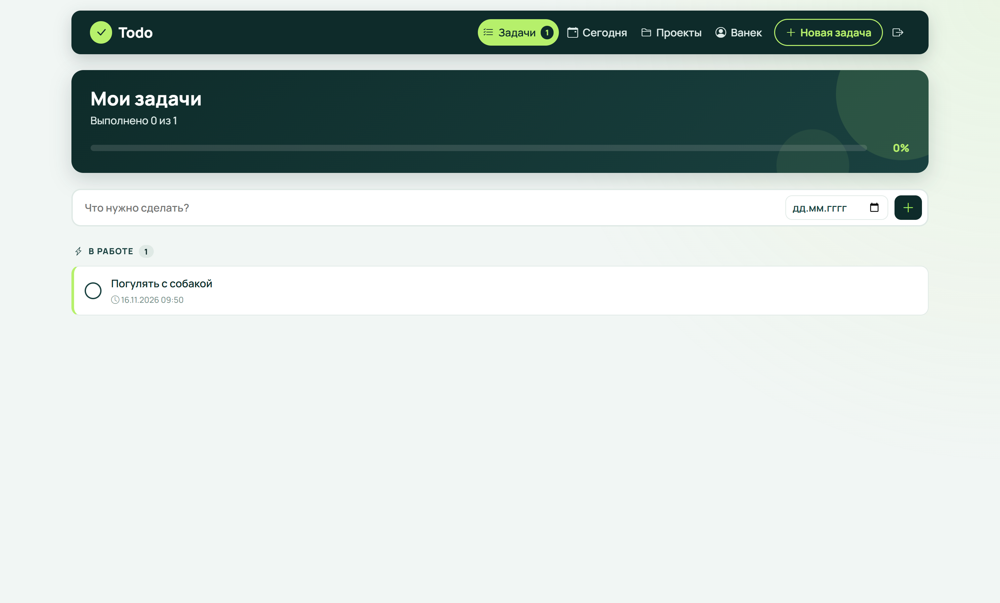
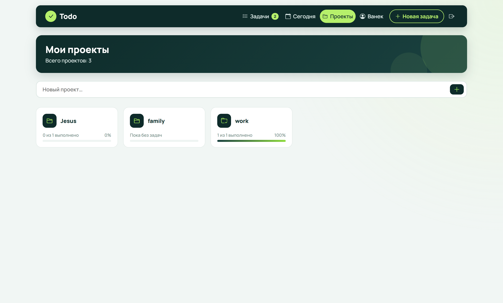
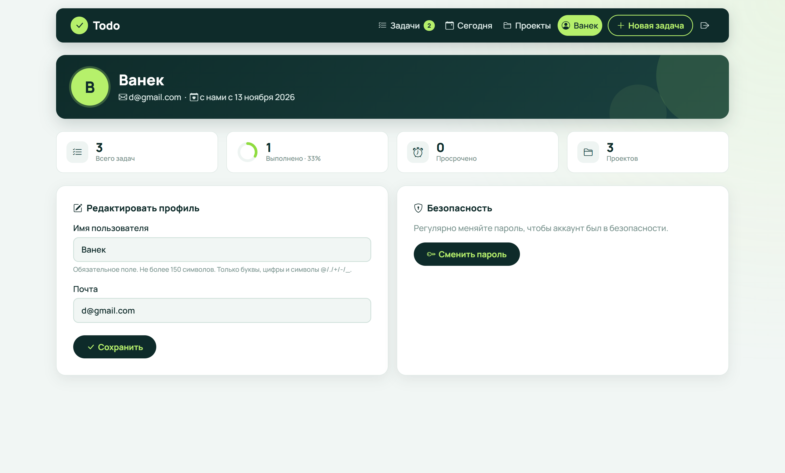
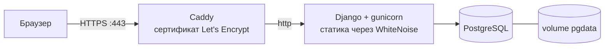

# ToDo: задачи и проекты на Django

**Живой сайт: [todo-arthur.ru](https://todo-arthur.ru)**. Регистрация открыта, можно завести аккаунт и попробовать.





Это мой учебный проект, но не из тех, что запускают на `localhost` и забывают. Я хотел пройти весь путь целиком: от первой модели в Django до сайта, который открывается у любого человека с телефона, по своему домену и с замочком в адресной строке.

Само приложение — простой менеджер задач. Простой намеренно: мне было важнее довести до конца маленькую вещь, чем бросить на середине большую.

## Что умеет

- **Аккаунты:** регистрация, вход, выход, смена пароля, редактирование профиля
- **Задачи со сроком:** можно отметить выполненной, вернуть обратно или удалить
- **«Сегодня»:** задачи на сегодня и отдельно всё просроченное, чтобы ничего не потерялось
- **Проекты:** задачи группируются, у каждого проекта виден прогресс в процентах
- **Счётчик в шапке:** сколько задач ещё не сделано, на любой странице
- **Умная сортировка:** сначала невыполненные, потом по сроку, задачи без срока в конце

## Что внутри, и почему так

Несколько решений, которые я считаю важными:

- **Каждый видит только своё.** Любой запрос к задачам и проектам фильтруется по владельцу. Если подставить в адрес чужой `id`, вернётся 404, а не чужие данные.
- **Изменения только через POST.** Удаление и отметка «выполнено» не срабатывают по обычной ссылке (`@require_POST`), а формы защищены CSRF-токеном.
- **Безопасный «возврат назад».** После действия сайт возвращает пользователя на страницу, с которой он пришёл. Но адрес проверяется через `url_has_allowed_host_and_scheme`, поэтому увести человека на чужой сайт через параметр `next` нельзя.
- **Прогресс считает база, а не Python.** Проценты по проектам считаются одним запросом через `annotate` + `Count` с фильтром, без цикла запросов по каждому проекту.
- **Свой модуль пользователя** (`AbstractUser`), заведённый с самого начала. Если понадобятся новые поля, не придётся мучиться с миграциями.
- **Интерфейс на Bootstrap 5**, плюс немного своего JS для анимаций. Без JavaScript всё тоже работает, он только украшает.

## Как это работает в продакшене



Всё запускается одной командой через Docker Compose на виртуальной машине в Yandex Cloud:

| Часть | Что использую |
|---|---|
| Бэкенд | Python 3.12, Django 6.1 |
| База данных | PostgreSQL 17 (в разработке без Docker используется SQLite) |
| Сервер приложения | gunicorn |
| Статика | WhiteNoise |
| HTTPS и домен | Caddy 2: сам получает и продлевает сертификат, перенаправляет http → https |
| Окружение | Docker, Docker Compose, Ubuntu 24.04, Yandex Cloud |

Секреты (ключ Django, пароль базы) лежат в `.env` и не попадают ни в git, ни в Docker-образ. Порт приложения наружу не открыт: все запросы проходят только через Caddy. Caddy вынесен в профиль `prod`, поэтому дома он не запускается, а на сервере его включает одна строка в `.env`.

## Запустить у себя

Код проекта лежит в папке `ToDo/`.

### Через Docker (как в продакшене)

```bash
git clone https://github.com/crstalk/todo-django.git
cd todo-django/ToDo
cp .env.example .env          # и впишите свои значения
docker compose up -d --build
docker compose exec web python manage.py createsuperuser
```

Сайт откроется на http://localhost:8000.

### Без Docker (быстро посмотреть)

```bash
cd todo-django/ToDo
python -m venv .venv
.venv\Scripts\activate        # Windows; на Linux/macOS: source .venv/bin/activate
pip install -r requirements.txt
python manage.py migrate
python manage.py runserver
```

Без `.env` проект сам переключится в режим разработки: SQLite и `DEBUG` включён.

### Обновить сайт на сервере

```bash
git pull
docker compose up -d --build
```

Данные пользователей при этом остаются: они хранятся в volume, а не внутри контейнера.

## Что было сложнее всего

Честно: не сам Django, а всё, что вокруг него. Несколько моментов, которые запомнились лучше любой теории:

- **Одна пропущенная запятая.** Я забыл запятую в списке `MIDDLEWARE`. Python молча склеил две соседние строки в одну, а Django сообщил, что не может найти `SessionMiddleware`. Ошибка была в одном месте, а сообщение — про совсем другое. С тех пор ставлю запятую после каждого элемента списка, даже последнего.
- **Первый `docker rm`, и все пользователи исчезли.** Так я по-настоящему понял, что контейнер одноразовый и зачем базе нужен volume.
- **Отступы в YAML.** Два лишних пробела, и Compose считает `volumes` отдельным сервисом. Теперь всегда проверяю файл через `docker compose config`.
- **Образ и контейнер — это разное.** `docker run todo` вместо `docker run todo-app` отправил Docker искать несуществующий образ в интернете.
- **CSRF за прокси.** Чтобы после включения HTTPS не сломалась форма входа, Django нужно было объяснить, что он стоит за Caddy (`SECURE_PROXY_SSL_HEADER`).

Главное, чему я научился: читать ошибку с конца, смотреть логи (`docker compose logs`) и не паниковать. Почти всегда причина оказывалась мелкой.

## Что хочу сделать дальше

- [ ] Резервные копии базы по расписанию (`pg_dump` + cron)
- [ ] Тесты на основные сценарии: изоляцию данных пользователей, задачи, проекты
- [ ] Автоматический деплой через GitHub Actions после `git push`
- [ ] Редактирование задач и перенос задач между проектами

## На этом всё, всем добра!

